<div align="center">

# 🧭 Git Compass

**Find your way in Git, GitHub & CI/CD: learn from zero or jump straight to the fix you need.**

Searchable guides · an in-browser git simulator with animated commit graphs · game challenges · a GitHub settings tour · a CI/CD lab · a 3D guide bot


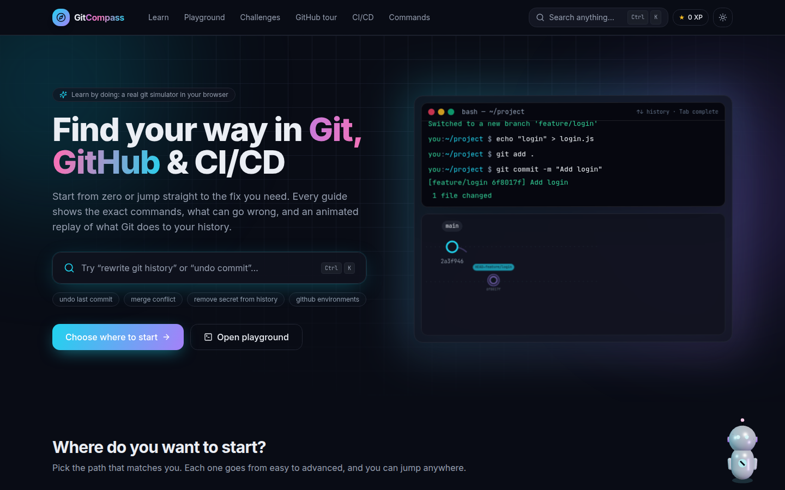

</div>

---

## Why

Git documentation tells you *what* a command does. Git Compass shows you **what it does to your repository**, step by step, and answers the questions people actually search for:

- *"How do I undo my last commit?"*
- *"How do I rewrite git history to remove a leaked password?"*
- *"What is a GitHub Environment and when do I need one?"*
- *"What even is a CI/CD pipeline?"*

Beginners pick where to start. Experienced developers press `Ctrl K`, type the problem, and get the exact commands, the risks, and how to undo them.

## Features

| | |
|---|---|
| 🔎 **Search everything** (`Ctrl K` or `/`) | Fuzzy search with a word-coverage re-rank across 64 guides, 17 GitHub settings, 39 commands, 16 challenges and 4 workflows. "git history rewrite" and "rewrite git history" both find the right guide. |
| 🗺️ **Learning paths** | Git from zero → Branching & merging → Remotes & GitHub sync → Fix mistakes & rewrite history → GitHub features → CI/CD. Start anywhere; progress is saved in your browser. |
| 📖 **Guides with one shape** | When to use · How it works · **animated demo** · Step by step (copyable commands) · What can go wrong · How to undo · Pro tips · Related. |
| 🖥️ **Git simulator** | A deterministic git engine written for the browser: commits, index, working tree, branches, merges with real conflicts, rebase, cherry-pick, revert, reset modes, stash, tags, reflog (`HEAD@{n}`), remotes with push/fetch/pull, `--force-with-lease`, and even `git filter-repo`. |
| 🌳 **Animated commit graph** | Every command animates the graph (lanes per branch, HEAD, `origin/*`, tags). Panels show the working directory, staging area, HEAD commit and the GitHub remote. |
| 🎮 **Challenges** | 16 game levels in 5 worlds (Basics → Rewrite), goals that tick off live, hints, XP and ranks from *Newcomer* to *History Wizard*. |
| ⚙️ **GitHub settings tour** | Every item of a repository's Settings sidebar (Rulesets, Branches, Actions, Environments, Deploy keys, Secrets and variables…) with what it is, when to use it, setup steps, best practices and pitfalls. |
| 🚀 **CI/CD lab** | Vocabulary, a pipeline you can run (and break with a bug to watch CI protect production), 11 lessons, and real workflow files explained line by line. |
| 📝 **Changelog & PR writer** | Paste commit messages (`git log --oneline` output or plain subjects) and get a Keep a Changelog section, a pull request description or GitHub release notes, grouped into features, fixes and more, with links to commits and PRs and a suggested semver bump. Runs in the browser; nothing is uploaded. Guides: *Write a pull request people want to review*, *Turn commit messages into a changelog*, *Keep a changelog and release notes*. |
| 🤖 **Compass, the 3D guide bot** | A three.js robot that follows your cursor, greets you on each page, flies next to the element it is explaining, and turns questions into searches. It can be hidden. |
| 🌗 Light/dark theme, mobile-friendly, reduced-motion aware, keyboard friendly. |

## Screenshots

| Search | Guide with animated demo |
|---|---|
| 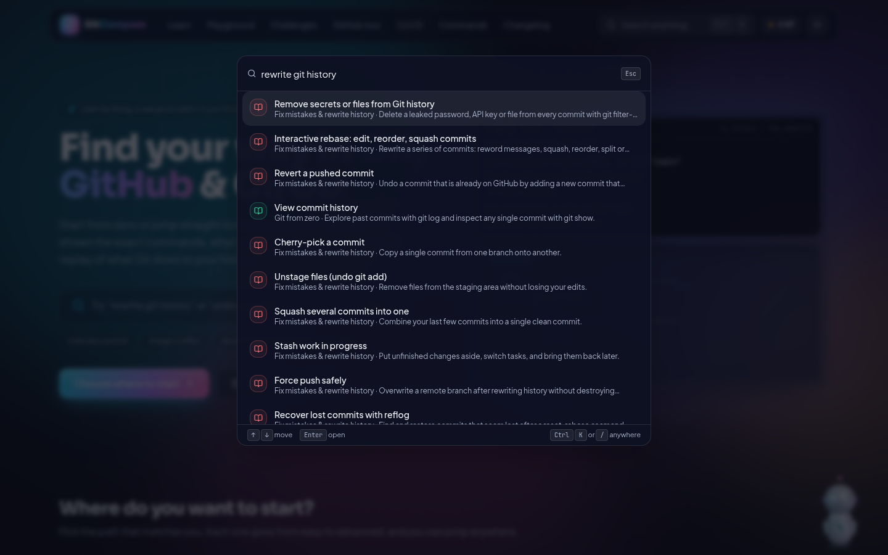 | 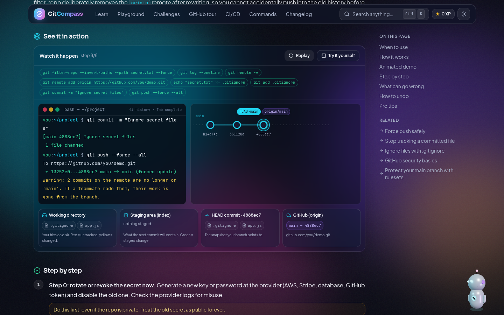 |
| **Playground** | **Challenge** |
| 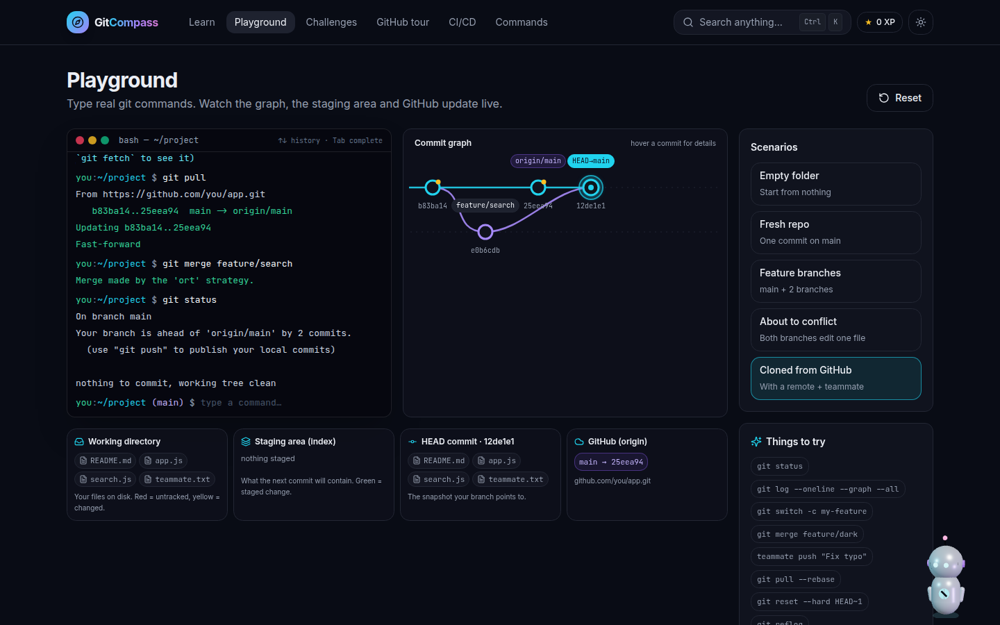 | 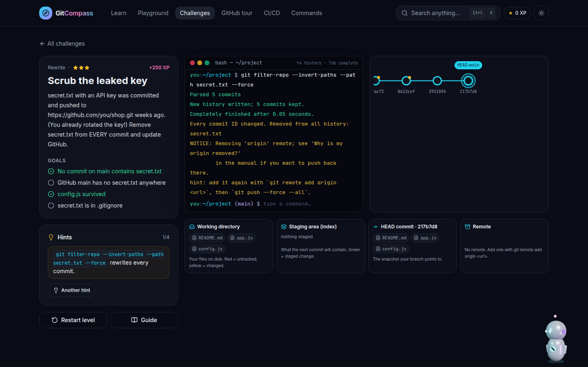 |
| **GitHub settings tour** | **CI/CD pipeline** |
| 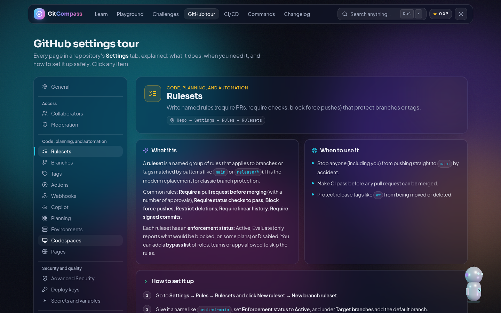 | 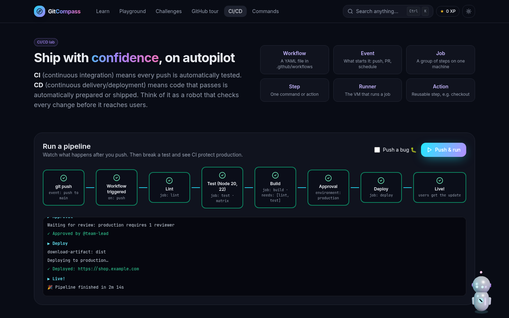 |
| **Workflow explorer** | **3D guide bot tour** |
| 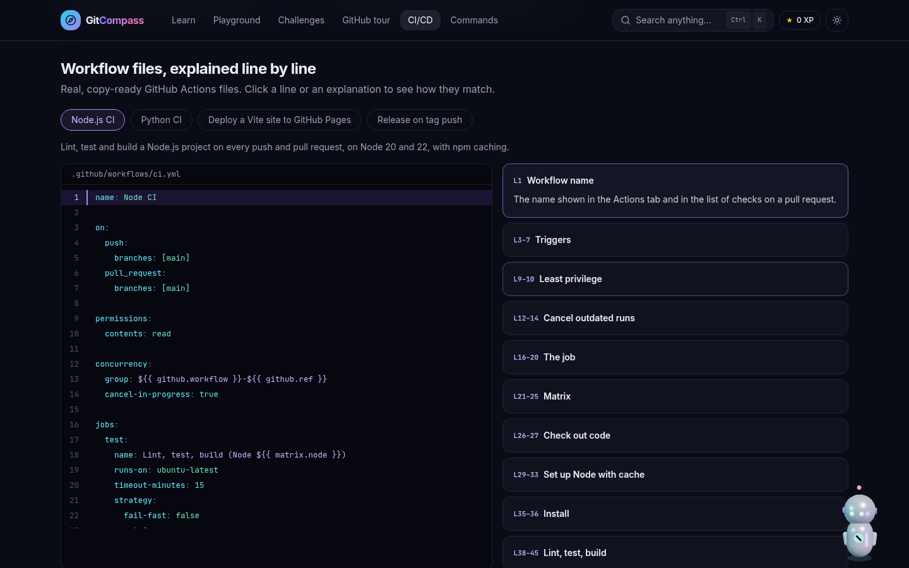 | 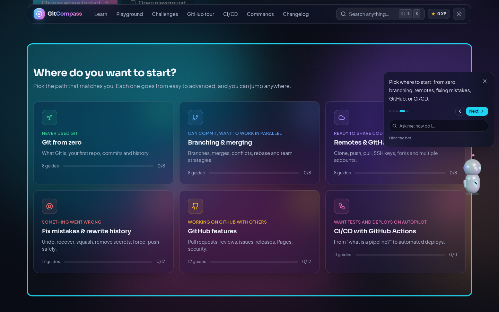 |
| **Changelog & PR writer** | **Generated PR description** |
| 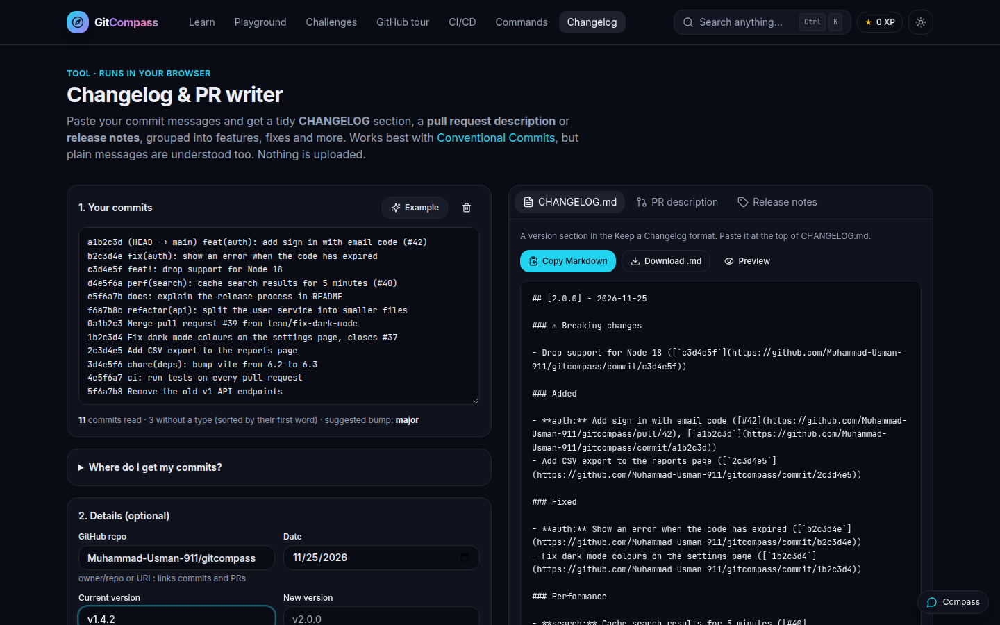 | 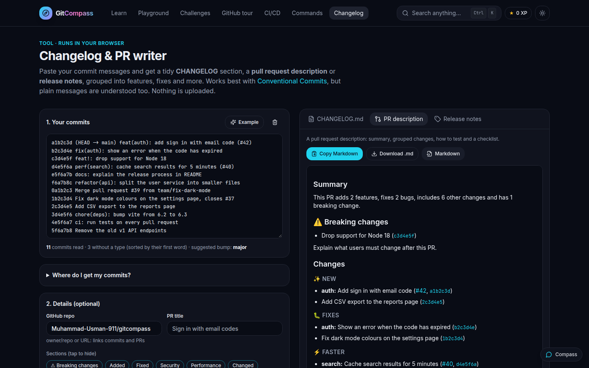 |

<details>
<summary>More screenshots</summary>

| Challenges | Command reference | Learning path |
|---|---|---|
| 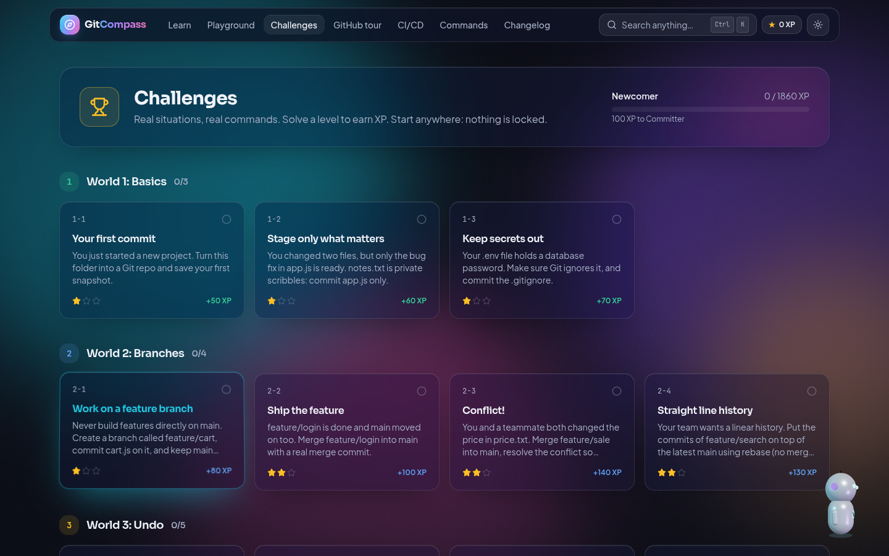 | 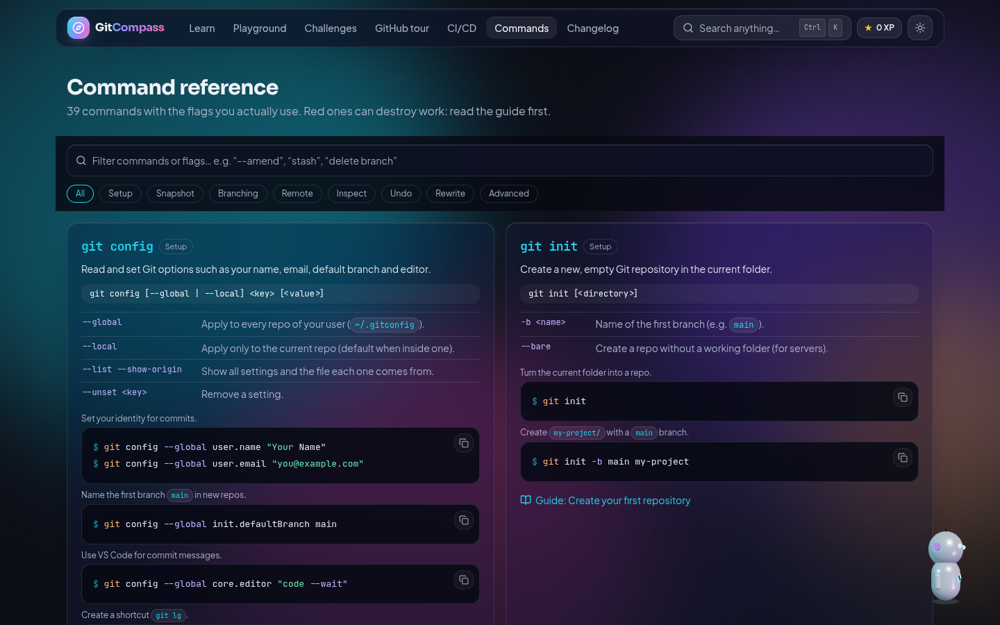 | 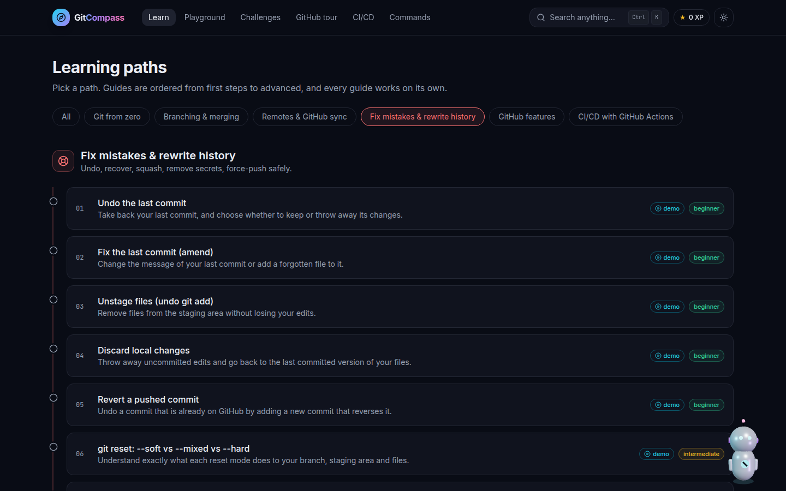 |

| Mobile home | Mobile guide |
|---|---|
| 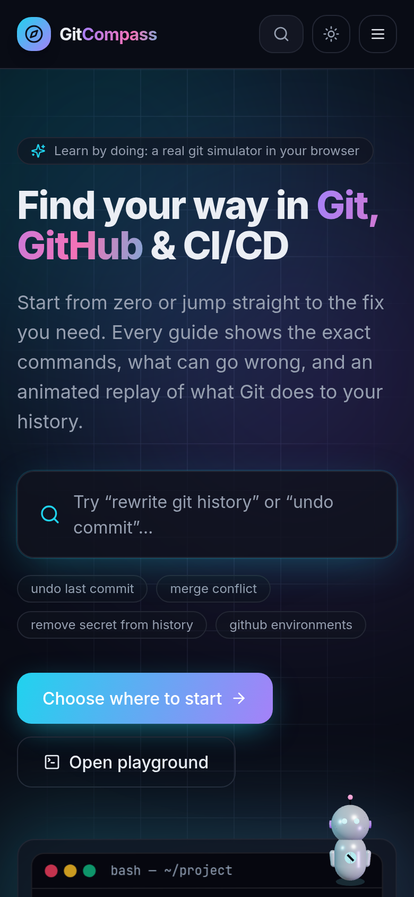 | 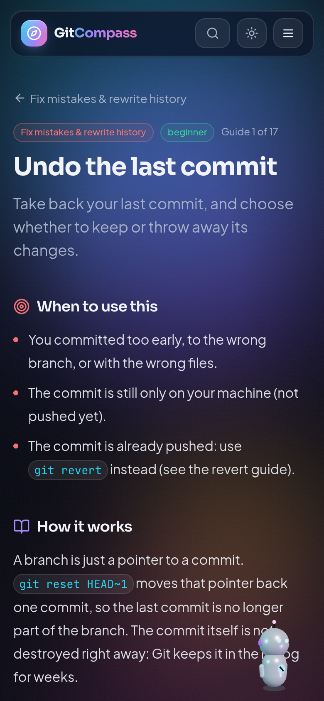 |

</details>

## Getting started

Requires Node 20+.

```bash
npm install
npm run dev        # http://localhost:5173
```

| Command | What it does |
|---|---|
| `npm run dev` | Dev server with hot reload |
| `npm test` | Simulator, challenge, content and search tests (Vitest) |
| `npm run typecheck` | TypeScript check |
| `npm run build` | Typecheck + production build to `dist/` |
| `npm run preview` | Serve the production build |

## How it works

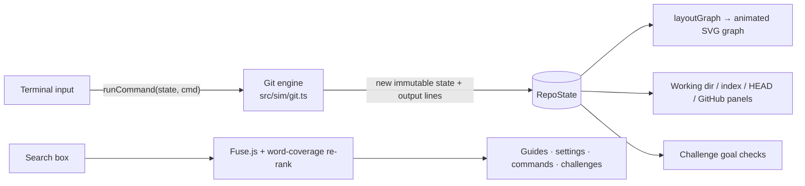

- **The engine is pure.** `runCommand(state, input)` returns a new state plus terminal lines and never mutates its input. A failed command returns the old state unchanged, just like a rejected git command.
- **Remotes are real objects.** `git remote add origin <url>` connects to a "server" keyed by URL, so `git filter-repo` can drop `origin` (as the real tool does) and re-adding the same URL reconnects to the old history for `git push --force --all`.
- **`teammate push "msg"`** is a simulator-only helper that pushes a commit to `origin` as a teammate, to demo fetch/pull, rejected pushes and force-push danger.
- **Content is typed data** in `src/content/` (types in `src/content/types.ts`). Each guide's `sandbox` demo is replayed by the same engine, and a test runs every demo to make sure it works.

## Project structure

```
src/
├── sim/           git engine, graph layout, challenges (+ tests)
├── content/       guides (6 paths), GitHub settings, commands, workflows (+ integrity test)
├── components/    layout, search palette, code blocks, sim/ (terminal, graph, panels, demos)
├── pages/         Home, Learn, Guide, Playground, Challenges, GitHub tour, CI/CD, Commands
├── bot/           3D guide bot (react-three-fiber), per-page tours
└── lib/           search, progress (XP), inline markup, utils
```

## Adding content

1. Add a `Guide` object to the right file in `src/content/guides/` (read [`CONTENT_GUIDE.md`](CONTENT_GUIDE.md) for the style and the commands the simulator supports).
2. Run `npm test`: it checks unique ids, that `related` links exist, and that every `sandbox` demo runs without errors.

## Deployment

It is a static site. `vercel.json` rewrites every route to `index.html` so deep links like `/guide/undo-last-commit` work. On Vercel: framework *Vite*, build `npm run build`, output `dist`.

## Roadmap

- Interactive rebase and `git bisect` in the simulator
- Shareable playground links with the full command history
- Quizzes at the end of each learning path
- More languages for the content

---

Built by [Muhammad Usman](https://github.com/Muhammad-Usman-911).
